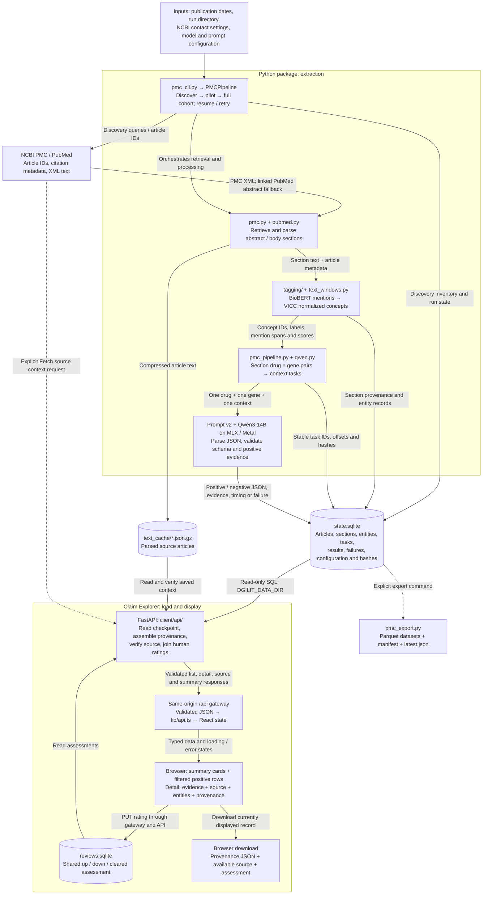
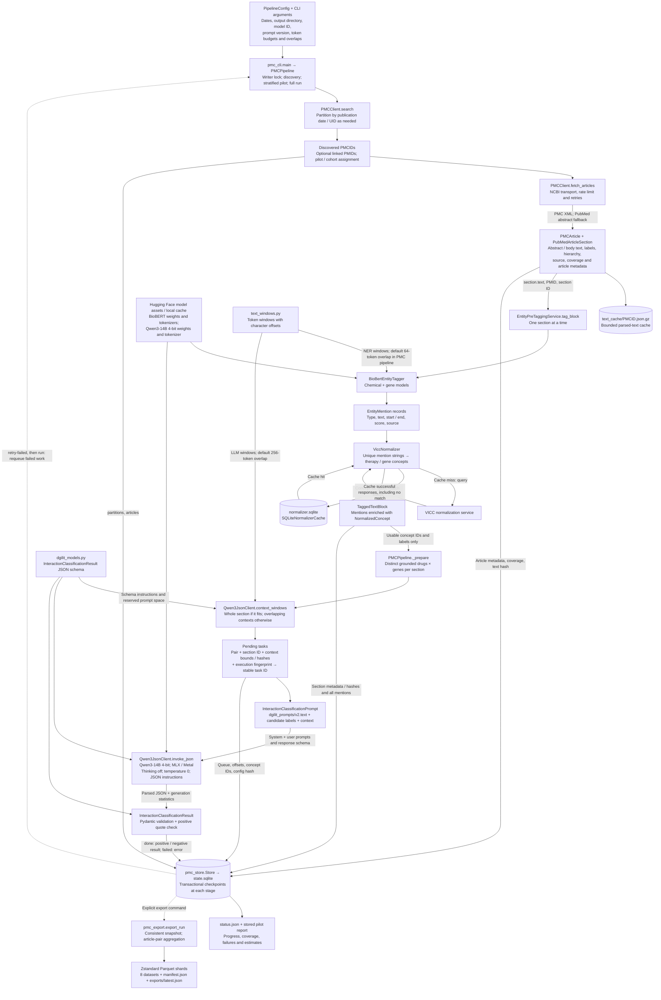

# dgiLIT: literature to Claim Explorer

This diagram follows the implementation in this checkout: the Python package generates a resumable extraction run, and Claim Explorer reads that run through a local Python API. Arrows are labeled with the inputs or outputs passed between components. Dashed arrows indicate optional paths.

## End-to-end workflow



**The client loads `state.sqlite` directly through the API. Parquet export is a separate output.** The extractor and browser are independent processes. New saved results appear after a search, page change, or manual refresh; there is no push subscription.

## Inside the Python package



Each task assesses **one normalized drug–gene pair in one context**. Two drugs × three genes × three contexts produce 18 tasks. Candidates are formed within a section, and every pair is assessed against every required context of that section; evidence is not combined across separate sections. A section with no grounded drug–gene pair produces no classifier tasks.

`InteractionClassificationResult` contains `drug`, `gene`, `interaction`, `evidence`, `interaction_type`, `directionality`, and `error_message`. Successful task records add quote verification, model/prompt settings, generation statistics, attempts and elapsed time. A positive response without a verifiable quote becomes a failed task.

The export datasets are `articles`, `partitions`, `sections`, `entities`, `classifications`, `article_pairs`, `positive_interactions`, and `failures`. Any supported positive context makes an article pair positive. A negative pair requires all tasks to finish negatively and article processing to finish; missing or failed work remains unresolved. Positive pairs may still have unresolved additional contexts.

### Other public package entry points

These reuse package components but do not automatically populate the PMC checkpoint used by the client:

| Component | Inputs | Outputs / connection |
| --- | --- | --- |
| [`dgilit.__init__`](../src/dgilit/__init__.py) | Python imports | Public retrieval, tagging, model and prompt classes; no workflow starts on import. |
| [`PubMedClient`, `fetch_pubmed_abstracts`](../src/dgilit/pubmed.py) | PMID list, NCBI settings, optional full-text enrichment | Structured `PubMedArticle` objects with sections, or PMID → text mappings for notebook workflows. PMC retrieval also reuses the PubMed parser for fallback. |
| [`PubTator3ChemicalTagger`](../src/dgilit/tagging/taggers.py) | Local PubTator annotation file, text and matching PMIDs | Additional chemical mentions. Optional notebook tagging route; the PMC CLI uses BioBERT alone. |
| [`CompositeEntityTagger`](../src/dgilit/tagging/taggers.py) | Multiple taggers, such as BioBERT + PubTator | Combined mentions supplied to the same `EntityPreTaggingService`. |
| [`TaggerConfig`](../src/dgilit/tagging/taggers.py) | Entity types, batch/device/window settings | Controls NER. Optional disease tagging/normalization exists; PMC candidate generation uses drugs and genes. |
| [`InteractionExtractionInput`](../src/dgilit/tagging/models.py) | A `TaggedTextBlock` | Context, tagged entity records, IDs and run/skip flags for custom downstream extraction. The PMC pipeline constructs pair-specific classification payloads directly. |
| [`InteractionClassificationPrompt`](../src/dgilit/dgilit_models.py) + WAGS `StructuredTaskRunner` | Registered prompt, candidate pair/context, response model, chosen LLM client | Validated notebook classification; examples use Qwen or Claude/Bedrock. `PMCPipeline` calls `invoke_json` directly and validates with Pydantic itself. |
| [Test-set notebooks](../notebooks/test_sets/) | Curated workbooks / PMID lists, package services, LLM settings | Experiment-specific tables, CSV/Parquet and evaluation results. These are separate from the CLI run consumed by Claim Explorer. |
| [PMC analysis notebook](../notebooks/pmc_last10years/01_pmc_interactions.ipynb) | Existing `state.sqlite`, optional cached text | Read-only progress plots, rankings, evidence and failure inspection; a parallel consumer of the same extraction run. |

## How data is loaded into the client

```mermaid
sequenceDiagram
    actor User
    participant UI as React components
    participant Gateway as lib/api.ts + /api gateway
    participant API as FastAPI app + contracts
    participant Repo as Repository + provenance
    participant State as state.sqlite (read-only)
    participant Ratings as RatingRepository / reviews.sqlite
    participant Source as SourceService
    participant Text as text_cache / memory cache
    participant NCBI as PMCSourceProvider / NCBI

    Note over UI,API: npm run dev launches Vinext/Vite on 5173 and FastAPI on 8000
    Note over API,State: DGILIT_DATA_DIR selects an existing run; connections use mode=ro and query_only=ON

    User->>UI: Open /, search, change page, or refresh
    UI->>Gateway: GET contexts?filters&page + GET summary
    Gateway->>API: Forward supported routes to DGILIT_API_ORIGIN
    API->>Repo: Query positive contexts and global summary
    Repo->>State: Join active tasks, articles, sections and metadata
    opt Rating filter selected
        Repo->>Ratings: Read assessment store before count / pagination
    end
    State-->>Repo: Saved positive rows, counts and run metadata
    Repo-->>API: Bounded result page / summary
    API->>Ratings: Read page assessments by task ID
    Ratings-->>API: rating + rated_at
    API-->>Gateway: Validated ContextPage / Summary JSON
    Gateway-->>UI: Typed data → React state
    UI-->>User: Summary cards, filters, 50-row table, rating badges

    User->>UI: Open /contexts/task_id
    UI->>Gateway: GET contexts/task_id
    Gateway->>API: Request saved positive task
    API->>Repo: Assemble task, matching mentions and related-context counts
    Repo->>State: Read original task / section plus current article metadata
    State-->>Repo: Saved result, entities, hashes and execution metadata
    Note over Repo: provenance.py verifies local prompt template against saved hash
    Repo-->>API: Detail + provenance + article links
    API->>Ratings: Read this task's assessment
    Ratings-->>API: rating + rated_at
    API-->>Gateway: Validated ContextDetail JSON
    Gateway-->>UI: Detail data

    UI->>Gateway: GET contexts/task_id/source
    Gateway->>API: Check existing source only
    API->>Source: Known task + section/context hashes and bounds
    Source->>Text: Read memory cache or compressed CLI article
    Text-->>Source: Available text, or missing / unreadable
    Source-->>API: Verify section hash and sliced context hash
    API-->>Gateway: SourceResult: state + exact context if verified
    Gateway-->>UI: SourceResult
    UI-->>User: Evidence, source state, entities, provenance and model JSON

    opt User clicks Fetch source context
        User->>UI: Retrieve missing / mismatched source
        UI->>Gateway: POST contexts/task_id/source
        Gateway->>API: Explicit retrieval request
        API->>Source: Retrieve source for validated saved task
        Source->>NCBI: Reuse dgilit PMC retrieval / PubMed parsing
        NCBI-->>Source: Parsed sections, or retrieval failure
        Source->>Source: Verify section and context hashes
        Source->>Text: Retain verified fetched result in memory only
        Source-->>API: verified / hash_mismatch / unavailable / retrieval_error
        API-->>Gateway: SourceResult
        Gateway-->>UI: Updated source panel
    end

    opt User rates a claim
        User->>UI: Thumbs up / down, or click again to clear
        UI->>Gateway: PUT contexts/task_id/rating with up / down / null
        Gateway->>API: Rating request
        API->>Repo: Validate existing positive task
        Repo->>State: Read task, then close connection
        API->>Ratings: Save one current assessment per stable task ID
        Ratings-->>API: rating + rated_at
        API-->>Gateway: ClaimRating JSON
        Gateway-->>UI: Update selected control; reread list for latest badge
    end

    opt User downloads provenance
        User->>UI: Provenance JSON
        UI-->>User: Browser Blob download: displayed detail + source + human_assessment
    end
```

### Client components, inputs and outputs

All paths below are under `client/` unless otherwise noted.

| Component | Inputs | Outputs / responsibility |
| --- | --- | --- |
| [`scripts/dev-local.mjs`](../client/scripts/dev-local.mjs) | `PYTHON_BIN`, API/web ports, API origin | Starts Python/Uvicorn and the Vinext/Vite frontend; default URLs are `127.0.0.1:8000` and `127.0.0.1:5173`. |
| [`api/config.py`](../client/api/config.py) | `DGILIT_DATA_DIR`, `DGILIT_REVIEW_DB`, local prompt directory | Resolved checkpoint/review paths and cache lifetimes. Review DB must be outside the extraction directory. |
| [`api/repository.py`](../client/api/repository.py) | Search strings, cohort/coverage/rating filters, pagination, task ID | Read-only SQL results; list count and rows, global summary, original task detail, matching entities and related-context counts. |
| [`api/provenance.py`](../client/api/provenance.py) | Saved task/config fingerprint, current local prompt file | Article links and prompt version/hash/status; template text only when its saved hash matches. |
| [`api/sources.py`](../client/api/sources.py) | Known task, saved hashes/bounds, cached or retrieved sections | `verified`, `hash_mismatch`, `unavailable`, or `retrieval_error`; context text is returned only when verified. |
| [`api/upstream.py`](../client/api/upstream.py) | Saved PMCID/PMID and original section source; optional NCBI credentials | Explicit NCBI retrieval using package parsers; verified fetched text stays in a bounded 10-minute memory cache, with no extraction-file write. |
| [`api/ratings.py`](../client/api/ratings.py) | Task ID and `up`, `down`, or `null` | Shared current assessment + timestamp in `client/.local/reviews.sqlite` by default; latest save wins. |
| [`api/app.py`](../client/api/app.py) + [`contracts.py`](../client/api/contracts.py) | Validated HTTP parameters/bodies and service results | Health, summary, context-list/detail, source and rating JSON; handled error responses. Global summary is cached for 30 seconds, bypassed by manual refresh. |
| [`app/api/[...path]/route.ts`](../client/app/api/%5B...path%5D/route.ts) | Same-origin browser requests and `DGILIT_API_ORIGIN` | Forwards supported GET/POST/PUT routes to FastAPI; returns JSON. |
| [`lib/api.ts`](../client/lib/api.ts) | API path, request options, JSON response | Typed frontend contracts and fetch/error handling; formatting helpers. |
| [`app/page.tsx`](../client/app/page.tsx) → [`components/browser.tsx`](../client/components/browser.tsx) | URL search/page state, `ContextPage`, `Summary` | Global summary cards; filtered positive-context rows; evidence excerpts, article/cohort/coverage labels, rating badges and detail links. |
| [`app/contexts/[task_id]/page.tsx`](../client/app/contexts/%5Btask_id%5D/page.tsx) → [`components/context-detail.tsx`](../client/components/context-detail.tsx) | Task ID, detail JSON, source JSON | Evidence quote, source text/status, normalized concepts/mentions, article and section metadata, prompt/config/model provenance, raw result and JSON download. |
| [`components/claim-rating.tsx`](../client/components/claim-rating.tsx) | Task assessment and save response | Rating controls, selected/saving/error state and list badges. |
| [`app/layout.tsx`](../client/app/layout.tsx), [`globals.css`](../client/app/globals.css), UI components | React content and styling | Page shell, typography and visual presentation. |

The current list includes completed positive tasks whose article hash matches the article's current text. Both pilot and beyond-pilot articles appear by default, even if other tasks for the paper remain unfinished. A saved historical positive task can still be opened by its full 64-character task ID and is labeled as historical.

Full source text lives in the bounded compressed cache rather than section/task SQL records. Evidence quotes, entity spans, hashes and provenance survive text eviction. The saved quote-verification flag describes the extraction-time check; the client separately verifies that available source text still matches the exact saved input. Original tokenizer-rendered model messages were not persisted.

Human assessments are separate from AI predictions and do not trigger extraction or alter its results. The generated connector/D1/Drizzle scaffolding is outside this application's active checkpoint-to-screen path. Predictions and exports support expert review; this workflow does not automatically import approved claims into DGIdb.
